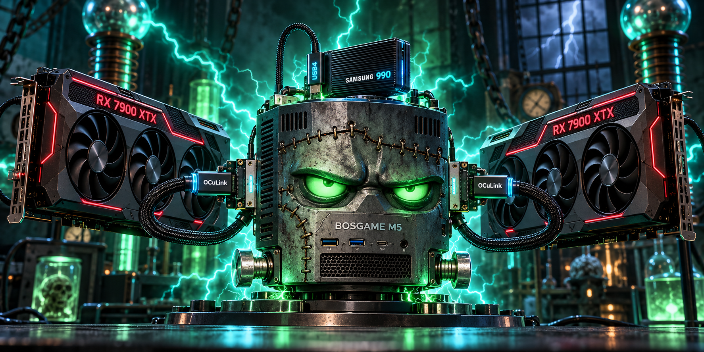
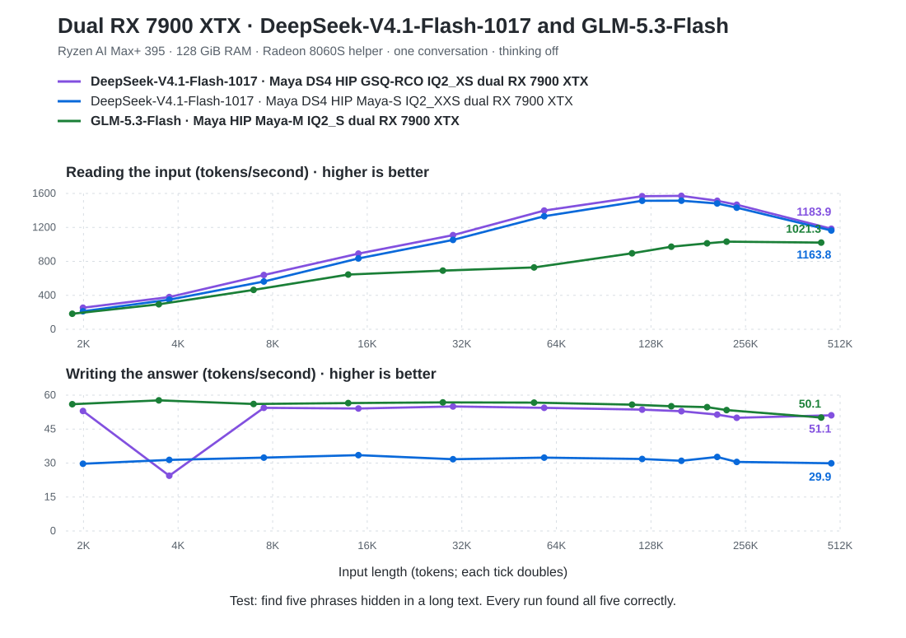
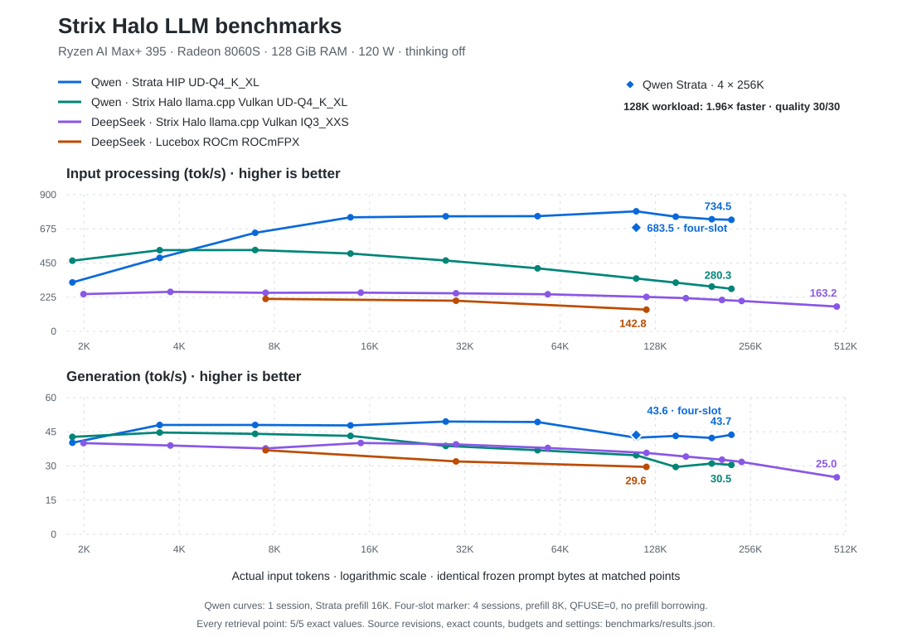

# Strix Halo LLM



A **BOSGAME M5 / Ryzen AI Max+ 395** with **two RX 7900 XTX cards** runs DeepSeek-V4.1-Flash-1017 and GLM-5.3-Flash locally. This repository contains the installable recipes, measured results, and pinned sources.

## Dual RX 7900 XTX setup

Both models use **two RX 7900 XTX cards** (48 GB VRAM), the M5's **Radeon 8060S and 128 GiB RAM**, and an **NVMe over USB4**. Each external GPU has its own PCIe 4.0 ×4 M.2-to-OCuLink link. [Full hardware list](#hardware).

Each setup supports **one conversation at up to 512K context**. Speeds are tokens per second: **decode** writes the answer; **prefill** reads the input. Tests use thinking off. Quality covers 10 coding and 20 maths cases; every retrieval prompt found all five values.

### DeepSeek-V4.1-Flash-1017 GSQ-RCO IQ2_XS (production)

**Maya DS4 HIP GSQ-RCO IQ2_XS dual RX 7900 XTX** uses [ISTA-DASLab's GSQ-RCO quant](https://huggingface.co/ISTA-DASLab/DeepSeek-V4.1-Flash-1017-GSQ-RCO-GGUF) and Maya v1.1.37 with serving fixes. [Ansible recipe](ansible/releases/maya-ds4-gsq-dual-xtx-512k.yml).

**Quality: 30/30. Perplexity: 7.3686** (23 × 2,048 tokens). **520K needle: 5/5.** All rows use a 524,288-token allocation.

| Test | Decode | Prefill |
|---|---:|---:|
| `maya.py --bench` (three 256-token answers; 2K / 8K prompts) | **59.0** | **203 / 535** |
| Public five-phrase prompt, 2K (2,040 input tokens) | 53.0 | 254 |
| 32K (30,720) | 55.0 | 1,109 |
| 128K (122,879) | 53.6 | 1,567 |
| 480K (491,520) | 51.1 | 1,184 |
| Real code, 130,048 tokens: cold / prompt cached | **53.1 / 60.8** | **1,390** |

### DeepSeek-V4.1-Flash-1017 Maya-S IQ2_XXS (alternative)

**Maya DS4 HIP Maya-S IQ2_XXS dual RX 7900 XTX** uses the 178 GB Maya-S quant and Maya v1.1.21 with engine patches. [Ansible recipe](ansible/releases/maya-ds4-dual-xtx-512k.yml).

**Quality: 30/30. 520K needle: 5/5.** All rows use a 524,288-token allocation.

| Test | Decode | Prefill |
|---|---:|---:|
| `maya.py --bench` (three 256-token answers; 2K / 8K prompts) | **41.9** | **177 / 474** |
| Public five-phrase prompt, 2K (2,040 input tokens) | 29.7 | 212 |
| 32K (30,720) | 31.7 | 1,053 |
| 128K (122,879) | 31.8 | 1,514 |
| 480K (491,520) | 29.9 | 1,164 |
| Real code, 130,048 tokens: cold / prompt cached | **36.1 / 44.6** | **1,278** |

### GLM-5.3-Flash Maya-M IQ2_S

**Maya HIP Maya-M IQ2_S dual RX 7900 XTX** uses the Maya-M quant with MTP drafting. [Ansible recipe](ansible/releases/maya-glm-dual-xtx-512k.yml).

**Quality: 28/30** (two maths misses). Input lengths below are GLM token counts.

| Test | Decode | Prefill |
|---|---:|---:|
| Public five-phrase prompt, 2K (1,886 input tokens) | 56.0 | 183 |
| 32K (28,517) | 56.8 | 691 |
| 128K (114,093), on the installed 512K service | **54.9** | **891** |
| Real code, the 130,048-token DeepSeek prompt (124,103 GLM tokens): cold / prompt cached | **54.2 / 55.4** | **652** |

The 2K and 32K rows use a 131,072-token allocation; the remaining rows use 524,288.

### Hardware

| Hardware | Quantity | Connection / role |
|---|---:|---|
| BOSGAME M5 / Sixunited AXB35-02, Ryzen AI Max+ 395, Radeon 8060S, 128 GiB RAM, 2 TB internal SSD | 1 | Host and integrated GPU |
| GIGABYTE Radeon RX 7900 XTX GAMING OC 24G | 1 | External GPU on PCIe 4.0 ×4 M.2-to-OCuLink |
| SAPPHIRE NITRO+ AMD Radeon RX 7900 XTX Vapor-X 24G | 1 | External GPU on PCIe 4.0 ×4 M.2-to-OCuLink |
| [M.2-to-OCuLink SFF-8612 riser and cable kit](https://allegro.pl/oferta/karta-adaptera-riser-oculink-sff-8612-m-2-pci-e-x16-4-0-rtx-5060-kabel-18681419859) | 2 | One kit per external GPU |
| ADATA XPG CORE REACTOR II 1000W | 1 | External GPU power supply |
| Samsung 990 PRO 1 TB M.2 NVMe SSD | 1 | External storage over USB4 |
| [AXAGON EEM2-40G USB4 40 Gbps enclosure](https://www.alza.cz/axagon-eem2-40g-m-2-nvme-ssd-enclosure-usb-c-40gbps-armored-aluminum-d13390080.htm) | 1 | Holds the Samsung SSD |
| Swissten USB 4.0 USB-C 240W 0.5 m cable | 1 | Connects the enclosure to the M5 |

### Performance curves

Cold five-phrase retrieval, one request per point except GSQ at 4K, where both the initial run and its recheck are shown. Both models read the same text; token counts vary by model. DeepSeek uses a 512K allocation throughout; GLM uses 128K–512K, as recorded in the [measurement details](docs/BENCHMARKS.md).



[DeepSeek measurements](docs/BENCHMARKS.md#dual-rx-7900-xtx-deepseek-v41-flash-1017) · [GLM measurements](docs/BENCHMARKS.md#dual-rx-7900-xtx-glm-53-flash) · [Exact result data](benchmarks/results.json)

### Install

Install one recipe at a time. The commands below select the production GSQ-RCO setup.

```bash
git clone https://github.com/pepuscz/strix-halo-llm.git
cd strix-halo-llm
cp ansible/inventory/hosts.example.yml ansible/inventory/hosts.yml
$EDITOR ansible/inventory/hosts.yml
python3 -m venv .venv
.venv/bin/pip install --require-hashes -r requirements.lock
export STRIX_SYSTEM=maya-ds4-gsq-dual-xtx
bin/strixctl validate
bin/strixctl install --allow-reboot
bin/strixctl verify
```

| Setup | `STRIX_SYSTEM` | Free disk needed |
|---|---|---:|
| **DeepSeek GSQ-RCO** | `maya-ds4-gsq-dual-xtx` | ~335 GB |
| DeepSeek Maya-S | `maya-ds4-dual-xtx` | ~470 GB |
| GLM Maya-M | `maya-glm-dual-xtx` | ~240 GB |

The installer verifies the hardware and artifacts, builds the runtime, and enables `strix-halo-inference.service` on `127.0.0.1:18109`. Dual-card recipes use ROCm 7.2.4; pinned build details are in [SOURCES.md](docs/SOURCES.md).

## BOSGAME M5 only

These setups run Qwen3.8-Flash-Next and DeepSeek-V4-Flash-0731 on the M5's Radeon 8060S and 128 GiB RAM, without external GPUs.

Each plotted point is one five-phrase retrieval request, scoring 5/5. Quality covers 10 coding and 20 maths questions. A **slot** holds one active conversation.

| Model | Stack | Conversation limit | Quality | Recipe / measurement settings |
|---|---|---|---:|---|
| Qwen3.8-Flash-Next | **Strata HIP UD-Q4_K_XL** | 4 conversations × 256K tokens | 30/30 | [strata-qwen-q4xl-4x256k.yml](ansible/releases/strata-qwen-q4xl-4x256k.yml) |
| Qwen3.8-Flash-Next | Strix Halo llama.cpp Vulkan UD-Q4_K_XL | 1 conversation, up to 256K in speed tests | 30/30 | [Measurement settings](docs/BENCHMARKS.md#qwen-context-scaling) |
| DeepSeek-V4-Flash-0731 | **Strix Halo llama.cpp Vulkan IQ3_XXS** | 1 conversation × 512K tokens | 30/30 | [vulkan-iq3xxs-512k.yml](ansible/releases/vulkan-iq3xxs-512k.yml) |
| DeepSeek-V4-Flash-0731 | Lucebox ROCm ROCmFPX | 1 conversation × 128K tokens | 29/30 | [rocm-rocmfpx-128k.yml](ansible/releases/rocm-rocmfpx-128k.yml) |

At 114,089 Qwen input tokens, the four-conversation **Strata HIP UD-Q4_K_XL** profile took **168.3 seconds**, versus **329.4 seconds** for the Qwen Vulkan comparison setup (1.96× faster). The four slots were also tested with four simultaneous 228,244-token conversations.



[Measurements and method](docs/BENCHMARKS.md#bosgame-m5-only) · [Exact result data](benchmarks/results.json)

For the single-box Qwen recipe, omit `STRIX_SYSTEM` in the install commands above; it is the controller default. Select the single-box DeepSeek recipe with `STRIX_SYSTEM=vulkan-iq3xxs` or the Lucebox comparison with `STRIX_SYSTEM=rocm-rocmfpx`.

## Host requirements and operations

The host runs Ubuntu 26.04 LTS with swap and Secure Boot disabled and the BIOS/large-GTT settings in [HOST-PLATFORM.md](docs/HOST-PLATFORM.md). The single-box Qwen recipe uses kernel `7.0.0-31-generic`; its DeepSeek recipes use `7.0.0-29-generic`. The dual-card recipes use `7.0.0-38-generic`.

[OPERATIONS.md](docs/OPERATIONS.md) covers service controls and updates. [ARCHITECTURE.md](docs/ARCHITECTURE.md) describes runtime settings and limits. [SOURCES.md](docs/SOURCES.md) records upstream provenance.

## License

The orchestration, scripts, and documentation are MIT licensed. Models, runtimes, libraries, drivers, and build dependencies retain their upstream licenses and terms. See [NOTICE.md](NOTICE.md).
