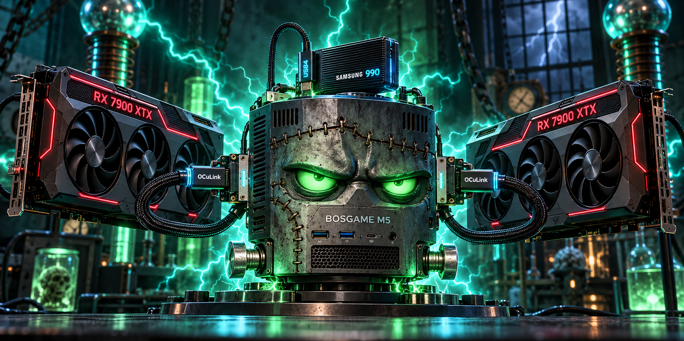
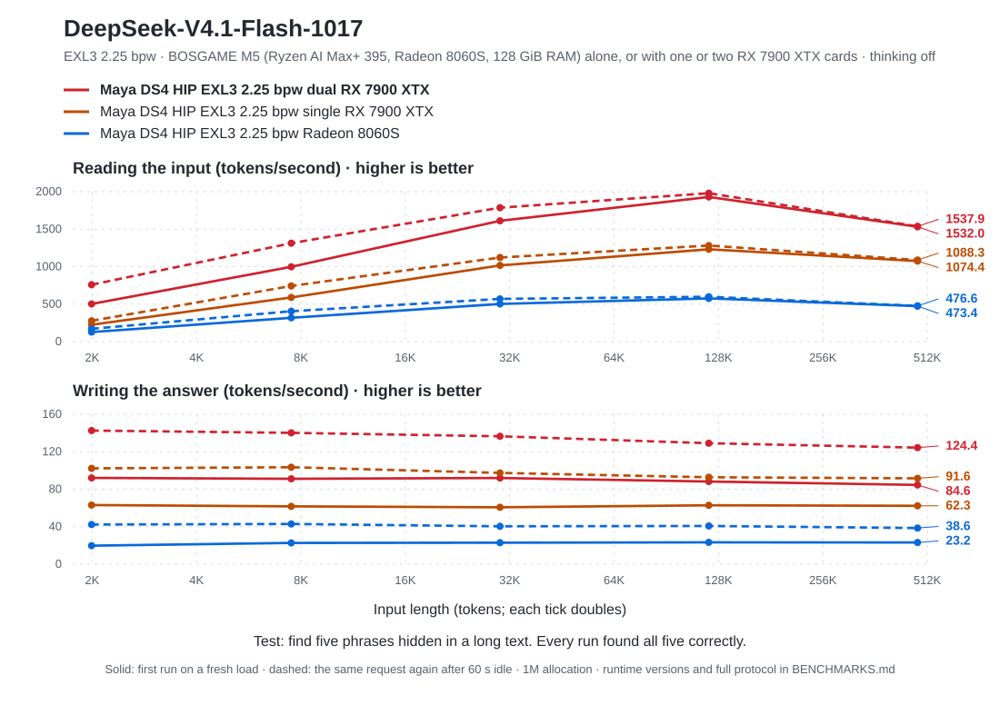
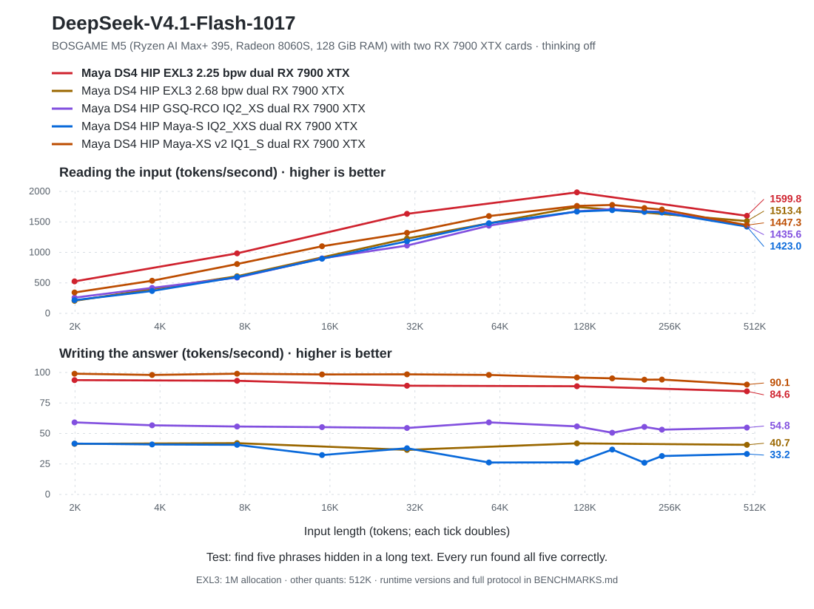
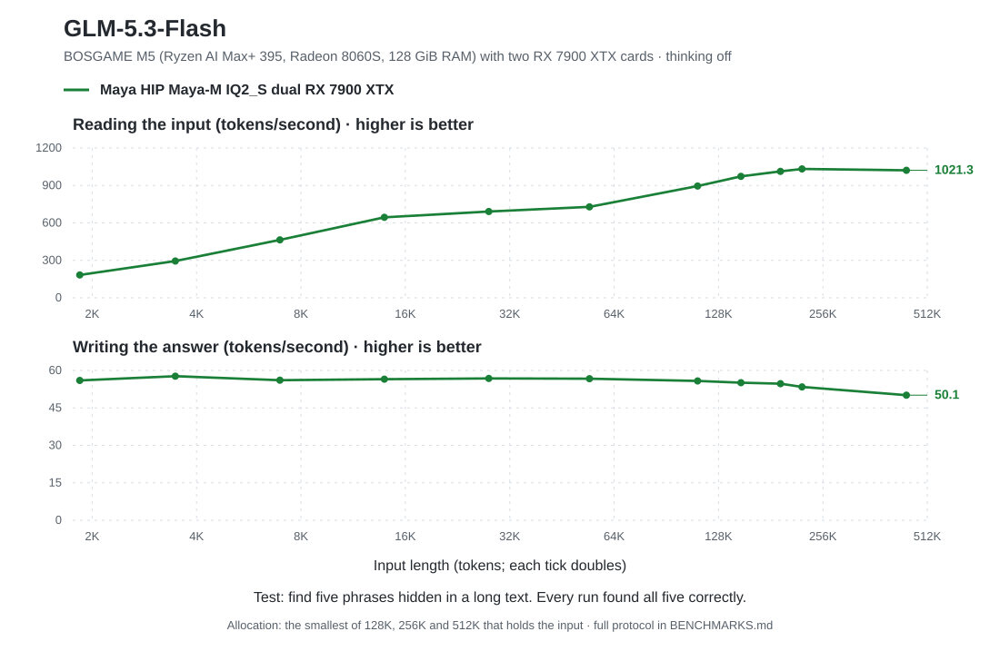
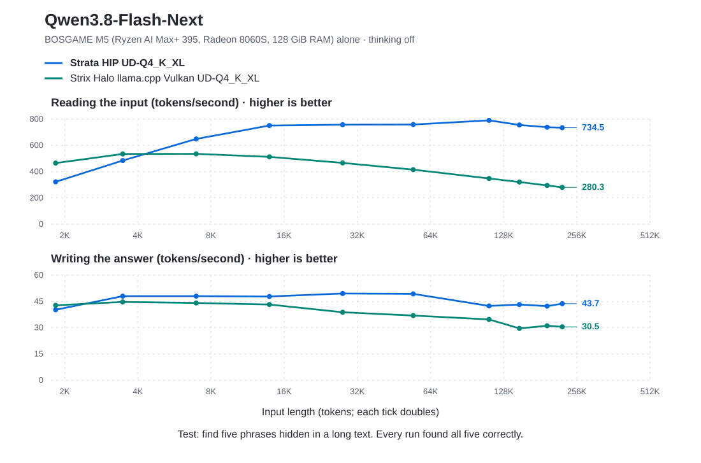
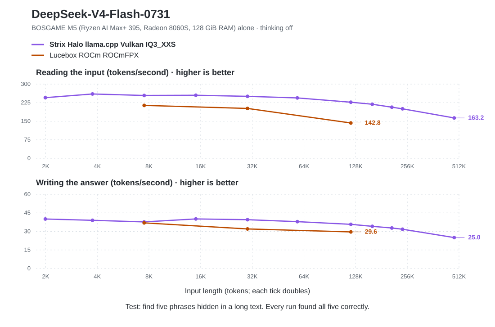

# Strix Halo LLM



Installable recipes, measured results and pinned sources for four models on a **BOSGAME M5 / Ryzen AI Max+ 395**, two of them with added RX 7900 XTX cards. Speeds are tokens per second: **decode** writes the answer, **prefill** reads the input; **quality** is how many of 10 coding and 20 maths tasks were solved.

## DeepSeek-V4.1-Flash-1017

Needs the M5 with two [RX 7900 XTX cards](#hardware), or one, and serves one conversation at a time. **Maya DS4 HIP EXL3 2.25 bpw** runs [turboderp's EXL3 quant](https://huggingface.co/turboderp/DeepSeek-V4.1-Flash-1017-exl3) with inputs up to **1M tokens**.

<!-- exl3-hardware-table -->
| EXL3 2.25 bpw | **2 × RX 7900 XTX** | 1 × RX 7900 XTX |
|---|---:|---:|
| Decode, short prompt | 70 | 46 |
| Decode, 128K input | 83 | 55 |
| Prefill, 8K input | 893 | 356 |
| Prefill, 128K input | 1,801 | 942 |
| Real code, 130K tokens: prefill / decode | 1,535 / 57 | 604 / 40 |
| Ansible recipe | [recipe](ansible/releases/maya-ds4-exl3-dual-xtx-1m.yml) | [recipe](ansible/releases/maya-ds4-exl3-single-xtx-1m.yml) |
<!-- /exl3-hardware-table -->



<!-- quant-comparison-note -->
EXL3 supports 1M context and decodes faster than GSQ-RCO at long inputs; it also reads prompts fastest. Maya-XS v2 decodes fastest, with higher perplexity.
<!-- /quant-comparison-note -->

<!-- quant-comparison-table -->
| 2 × RX 7900 XTX | **EXL3 2.25 bpw** | GSQ-RCO IQ2_XS | Maya-S IQ2_XXS | Maya-XS v2 IQ1_S |
|---|---:|---:|---:|---:|
| Longest input | 1M | 512K | 512K | 512K |
| Model size, excluding Engram | 159 GB | 155 GB | 178 GB | 117 GB |
| Perplexity (lower is better) | 7.19 | 7.37 | 7.25 | 7.94 |
| Quality checks passed | 29/30 | 30/30 | 30/30 | 30/30 |
| Decode, short prompt | 70 | 61 | 42 | 81 |
| Decode, 128K input | 83 | 56 | 26 | 96 |
| Prefill, 8K input | 893 | 537 | 478 | 661 |
| Prefill, 128K input | 1,801 | 1,673 | 1,669 | 1,762 |
<!-- /quant-comparison-table -->

GSQ-RCO keeps its own [recipe](ansible/releases/maya-ds4-gsq-dual-xtx-512k.yml); Maya-S and Maya-XS v2 were measured for comparison only.



[Measurements and method](docs/BENCHMARKS.md#deepseek-v41-flash-1017)

## GLM-5.3-Flash

Needs the M5 with two [RX 7900 XTX cards](#hardware) and serves one conversation at a time. **Maya HIP Maya-M IQ2_S dual RX 7900 XTX** uses the Maya-M quant with MTP drafting. [Ansible recipe](ansible/releases/maya-glm-dual-xtx-512k.yml).

**Quality: 28/30** (two maths misses).

| Input | Decode | Prefill |
|---|---:|---:|
| 2K (1,886 tokens) | 56.0 | 183 |
| 32K (28,517) | 56.8 | 691 |
| 128K (114,093) | 54.9 | 891 |
| Real code, 124,103 tokens: cold / prompt cached | 54.2 / 55.4 | 652 |



[Measurements and method](docs/BENCHMARKS.md#glm-53-flash)

## Qwen3.8-Flash-Next

Needs only the M5.

| Stack | Conversation limit | Quality | Recipe / measurement settings |
|---|---|---:|---|
| **Strata HIP UD-Q4_K_XL** | 4 conversations × 256K tokens | 30/30 | [strata-qwen-q4xl-4x256k.yml](ansible/releases/strata-qwen-q4xl-4x256k.yml) |
| Strix Halo llama.cpp Vulkan UD-Q4_K_XL | 1 conversation, up to 256K in speed tests | 30/30 | [Measurement settings](docs/BENCHMARKS.md#qwen-context-scaling) |

At 114,089 input tokens, the four-conversation Strata profile took **168.3 seconds**, versus **329.4 seconds** for Vulkan (1.96× faster). It was also tested with four simultaneous 228,244-token conversations.



[Measurements and method](docs/BENCHMARKS.md#qwen38-flash-next)

## DeepSeek-V4-Flash-0731

Needs only the M5.

| Stack | Conversation limit | Quality | Recipe |
|---|---|---:|---|
| **Strix Halo llama.cpp Vulkan IQ3_XXS** | 1 conversation × 512K tokens | 30/30 | [vulkan-iq3xxs-512k.yml](ansible/releases/vulkan-iq3xxs-512k.yml) |
| Lucebox ROCm ROCmFPX | 1 conversation × 128K tokens | 29/30 | [rocm-rocmfpx-128k.yml](ansible/releases/rocm-rocmfpx-128k.yml) |



[Measurements and method](docs/BENCHMARKS.md#deepseek-v4-flash-0731)

## Hardware

| Hardware | Quantity | Connection / role |
|---|---:|---|
| BOSGAME M5 / Sixunited AXB35-02, Ryzen AI Max+ 395, Radeon 8060S, 128 GiB RAM, 2 TB internal SSD | 1 | Host and integrated GPU |
| GIGABYTE Radeon RX 7900 XTX GAMING OC 24G | 1 | External GPU on PCIe 4.0 ×4 M.2-to-OCuLink |
| SAPPHIRE NITRO+ AMD Radeon RX 7900 XTX Vapor-X 24G | 1 | External GPU on PCIe 4.0 ×4 M.2-to-OCuLink |
| [M.2-to-OCuLink SFF-8612 riser and cable kit](https://allegro.pl/oferta/karta-adaptera-riser-oculink-sff-8612-m-2-pci-e-x16-4-0-rtx-5060-kabel-18681419859) | 2 | One kit per external GPU |
| ADATA XPG CORE REACTOR II 1000W | 1 | External GPU power supply |
| Samsung 990 PRO 1 TB M.2 NVMe SSD | 1 | External storage over USB4 |
| [AXAGON EEM2-40G USB4 40 Gbps enclosure](https://www.alza.cz/axagon-eem2-40g-m-2-nvme-ssd-enclosure-usb-c-40gbps-armored-aluminum-d13390080.htm) | 1 | Holds the Samsung SSD |
| Swissten USB 4.0 USB-C 240W 0.5 m cable | 1 | Connects the enclosure to the M5 |

**GPU tuning used for the DeepSeek EXL3 measurements:** both cards at −100 mV, a 350 W power cap and their stock clock ceilings (2,920 MHz Sapphire, 2,890 MHz Gigabyte), with automatic GPU DPM and CPU boost off. The recipe leaves the cards stock unless you set `strix_gpu_od_enabled: true` ([Operations](docs/OPERATIONS.md#optional-gpu-tuning)).

## Install

Install one recipe at a time; `STRIX_SYSTEM` selects it from the table below.

```bash
git clone https://github.com/pepuscz/strix-halo-llm.git
cd strix-halo-llm
cp ansible/inventory/hosts.example.yml ansible/inventory/hosts.yml
$EDITOR ansible/inventory/hosts.yml
python3 -m venv .venv
.venv/bin/pip install --require-hashes -r requirements.lock
export STRIX_SYSTEM=maya-ds4-exl3-dual-xtx
bin/strixctl validate
bin/strixctl install --allow-reboot
bin/strixctl verify
```

| Model | Setup | `STRIX_SYSTEM` | Free disk needed |
|---|---|---|---:|
| DeepSeek-V4.1-Flash-1017 | **EXL3 2.25 bpw, two cards** | `maya-ds4-exl3-dual-xtx` | ~423 GB |
| | EXL3 2.25 bpw, one card | `maya-ds4-exl3-single-xtx` | ~423 GB |
| | GSQ-RCO IQ2_XS, two cards | `maya-ds4-gsq-dual-xtx` | ~335 GB |
| GLM-5.3-Flash | **Maya-M IQ2_S, two cards** | `maya-glm-dual-xtx` | ~240 GB |
| Qwen3.8-Flash-Next | **Strata HIP UD-Q4_K_XL** (default when unset) | `strata-qwen-q4xl` | ~220 GB |
| DeepSeek-V4-Flash-0731 | **Strix Halo llama.cpp Vulkan IQ3_XXS** | `vulkan-iq3xxs` | ~120 GB |
| | Lucebox ROCm ROCmFPX | `rocm-rocmfpx` | ~120 GB |

The installer verifies the hardware and artifacts, builds the runtime, and enables `strix-halo-inference.service` on `127.0.0.1:18109`.

## Host requirements and operations

The host runs Ubuntu 26.04 LTS with swap and Secure Boot disabled and the BIOS/large-GTT settings in [HOST-PLATFORM.md](docs/HOST-PLATFORM.md). Kernels: `7.0.0-38-generic` for DeepSeek-V4.1 and GLM, `7.0.0-31-generic` for Qwen, `7.0.0-29-generic` for DeepSeek-V4-Flash-0731.

[OPERATIONS.md](docs/OPERATIONS.md) covers service controls and updates. [ARCHITECTURE.md](docs/ARCHITECTURE.md) describes runtime settings and limits. [SOURCES.md](docs/SOURCES.md) records upstream provenance.

## License

The orchestration, scripts, and documentation are MIT licensed. Models, runtimes, libraries, drivers, and build dependencies retain their upstream licenses and terms. See [NOTICE.md](NOTICE.md).
