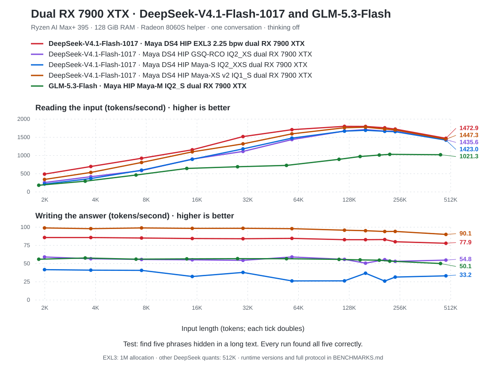
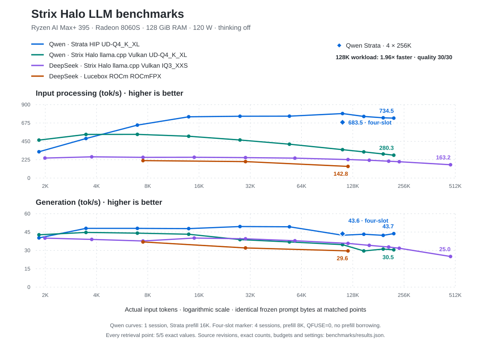

# Benchmarks

The dual RX 7900 XTX setups and the BOSGAME M5-only setups use different models and hardware. Their speeds are not a matched comparison. Prefill means reading the input; decode means writing the answer. Input tokens are model-specific counts, while context allocation is the memory reserved for a conversation.

The cold retrieval test places five labelled phrases at different positions in an input and asks the model to find them. Every recorded speed-test request found all five. Each point measures one request with no cached input. Detailed sources, settings and result data are linked below.

## Dual RX 7900 XTX: DeepSeek-V4.1-Flash-1017

**Maya DS4 HIP EXL3 2.25 bpw dual RX 7900 XTX** uses the qualified v1.1.56-based fork, original FP8 Engram, 16K prompt chunks and 1M context. [Ansible recipe](../ansible/releases/maya-ds4-exl3-dual-xtx-1m.yml).

GSQ, Maya-S and Maya-XS measurements use the v1.1.48 indexer engine at 512K. EXL3 uses 1M. The eleven curve points share identical input bytes, zero cached input, thinking off and a 256-token cap; each load is fresh, from the frozen profile. All five values were found at every point.

| | **EXL3 2.25 bpw** | GSQ-RCO IQ2_XS | Maya-S IQ2_XXS | Maya-XS v2 IQ1_S |
|---|---:|---:|---:|---:|
| Context allocation | 1M | 512K | 512K | 512K |
| Model shards, excluding Engram | 159 GB | 155 GB | 178 GB | 117 GB |
| Perplexity (23 × 2,048 tokens; lower is better) | 7.1973 | 7.3695 | 7.2498 | 7.9435 |
| Quality | 30/30 | 30/30 | 30/30 | 30/30 |
| 520K retrieval | 5/5 | 5/5 | 5/5 | 5/5 |
| 1.04M retrieval | 5/5 | — | — | — |
| Fixed-input Maya benchmark: decode | 60.3 | 60.9 | 41.7 | 80.7 |
| Fixed-input Maya benchmark: prefill 2K / 8K | 251 / 627 | 210 / 537 | 169 / 478 | 286 / 661 |
| 128K five-phrase: decode / prefill | 75.3 / 1,654 | 55.8 / 1,673 | 26.3 / 1,669 | 95.9 / 1,762 |
| 480K five-phrase: decode / prefill | 73.3 / 1,361 | 54.8 / 1,436 | 33.2 / 1,423 | 90.1 / 1,447 |
| Real code, 130,048 tokens: prefill | 1,434 | 1,464 | 1,378 | 1,587 |
| Real code: decode cold / prompt cached | 50.3 / 48.4 | 52.5 / 65.7 | 37.3 / 49.4 | 66.2 / 68.0 |

EXL3 supports 1M context and has the lowest measured perplexity (7.1973). It also decodes faster at long context (75.3 against GSQ-RCO's 55.8 tokens/s at 128K). Maya-XS v2 has the fastest recorded decode, with higher perplexity (7.9435).

GSQ and EXL3 report medians of three loads per point; Maya-S and Maya-XS each report one load. Cached decode uses three consecutive answers per load. Different answer text and draft acceptance mean these decode rates do not isolate kernel speed.

### Recorded context scaling

#### **Maya DS4 HIP EXL3 2.25 bpw dual RX 7900 XTX**

| Input tokens | Prefill (tok/s) | Decode (tok/s) | Values |
|---:|---:|---:|---:|
| 2,040 | 280.1 | 79.2 | 5/5 |
| 3,840 | 467.6 | 79.1 | 5/5 |
| 7,680 | 749.2 | 78.1 | 5/5 |
| 15,359 | 1,007.1 | 76.4 | 5/5 |
| 30,720 | 1,365.8 | 77.6 | 5/5 |
| 59,933 | 1,566.0 | 77.8 | 5/5 |
| 122,879 | 1,654.2 | 75.3 | 5/5 |
| 163,840 | 1,655.7 | 76.0 | 5/5 |
| 212,992 | 1,618.4 | 75.8 | 5/5 |
| 245,760 | 1,595.2 | 74.3 | 5/5 |
| 491,520 | 1,361.1 | 73.3 | 5/5 |

The separate **1,040,000-token** check found **5/5** values with zero cached input: **979.6 prefill / 67.4 decode tok/s**.

#### Maya DS4 HIP GSQ-RCO IQ2_XS dual RX 7900 XTX

| Input tokens | Prefill (tok/s) | Decode (tok/s) | Values |
|---:|---:|---:|---:|
| 2,040 | 258.3 | 59.1 | 5/5 |
| 3,840 | 418.2 | 56.7 | 5/5 |
| 7,680 | 587.0 | 55.7 | 5/5 |
| 15,359 | 901.7 | 55.2 | 5/5 |
| 30,720 | 1,112.3 | 54.5 | 5/5 |
| 59,933 | 1,438.4 | 59.1 | 5/5 |
| 122,879 | 1,672.8 | 55.8 | 5/5 |
| 163,840 | 1,710.8 | 50.6 | 5/5 |
| 212,992 | 1,670.2 | 55.4 | 5/5 |
| 245,760 | 1,667.0 | 53.1 | 5/5 |
| 491,520 | 1,435.6 | 54.8 | 5/5 |

#### Maya DS4 HIP Maya-S IQ2_XXS dual RX 7900 XTX

| Input tokens | Prefill (tok/s) | Decode (tok/s) | Values |
|---:|---:|---:|---:|
| 2,040 | 216.6 | 41.7 | 5/5 |
| 3,840 | 367.1 | 41.0 | 5/5 |
| 7,680 | 596.4 | 40.7 | 5/5 |
| 15,359 | 896.4 | 32.3 | 5/5 |
| 30,720 | 1,182.0 | 37.9 | 5/5 |
| 59,933 | 1,478.6 | 26.2 | 5/5 |
| 122,879 | 1,669.2 | 26.3 | 5/5 |
| 163,840 | 1,692.9 | 36.8 | 5/5 |
| 212,992 | 1,665.0 | 26.0 | 5/5 |
| 245,760 | 1,654.6 | 31.5 | 5/5 |
| 491,520 | 1,423.0 | 33.2 | 5/5 |

#### Maya DS4 HIP Maya-XS v2 IQ1_S dual RX 7900 XTX

| Input tokens | Prefill (tok/s) | Decode (tok/s) | Values |
|---:|---:|---:|---:|
| 2,040 | 342.8 | 99.0 | 5/5 |
| 3,840 | 535.1 | 98.0 | 5/5 |
| 7,680 | 809.2 | 99.0 | 5/5 |
| 15,359 | 1,100.9 | 98.4 | 5/5 |
| 30,720 | 1,320.4 | 98.5 | 5/5 |
| 59,933 | 1,595.6 | 98.0 | 5/5 |
| 122,879 | 1,762.3 | 95.9 | 5/5 |
| 163,840 | 1,778.5 | 95.2 | 5/5 |
| 212,992 | 1,727.3 | 94.1 | 5/5 |
| 245,760 | 1,703.0 | 94.2 | 5/5 |
| 491,520 | 1,447.3 | 90.1 | 5/5 |

### Fixed-input Maya benchmark

The [driver](../benchmarks/maya_bench.py) and [token fixture](../benchmarks/maya-bench-inputs.json) retain the public v1.1.28 benchmark procedure: three 256-token answers, greedy and thinking off, plus 2,048- and 8,192-token prompts. The comparison table above uses these same inputs for every quant.

### Upstream v1.1.56 benchmark at 1M

A separate source-native `maya.py --bench` comparison used the same actual token IDs, a 1,048,576-token allocation and two cold loads per arm, in optimized EXL3 / GSQ / stock EXL3 order, repeated once. These documentation tokens differ from the fixed-input fixture above.

| Setup | Decode mean (tok/s) | Prefill 2K / 8K (tok/s) |
|---|---:|---:|
| **Optimized EXL3 2.25** | 59.6 | 244.5 / 651.5 |
| GSQ-RCO IQ2_XS, stock v1.1.56 | 58.9 | 199.5 / 538.0 |
| EXL3 2.25, stock v1.1.56 | 48.6 | 230.5 / 650.0 |

The optimized arm is this release: its binary and recipe (the helper's 109 GB pool with the drafter's leftover experts, ~5 GB read ahead). The stock EXL3 arm keeps the retained stock reference recipe (a 95 GB pool, 14.9 GB read-ahead, no DS4_HELPER_DRAFT), so the rows compare the release with a stock reference, not binaries alone. GSQ uses its recipe at 1M. Each native decode mean covers three answers; changed text and draft acceptance prevent a stream-matched causal claim.

### Quality and teacher comparison

All four DeepSeek quants scored 30/30 on the cold coding/maths suite. The established math_08 gold-answer correction is retained. The perplexity values in the main table use 23 × 2,048 tokens.

The separate Lucebox held-out set has eight 1,024-token sequences and 8,184 predictions. KL uses the teacher’s top 256 probabilities; lower is better. Top-1 is agreement with the teacher.

| Quant | KL | Top-1 agreement | Held-out PPL |
|---|---:|---:|---:|
| **EXL3 2.25 (v1.1.56 fork)** | 0.1663 | 83.19% | 9.1906 |
| GSQ-RCO IQ2_XS (v1.1.50 indexer) | 0.2272 | 80.51% | 9.6736 |

The EXL3 dump/PPL consistency check differed by 0.27%, within the fixed 2% tolerance. Maya-S and Maya-XS were not measured with this KL driver. [Exact data and input hashes](../benchmarks/results.json).

## Dual RX 7900 XTX: GLM-5.3-Flash

**Maya HIP Maya-M IQ2_S dual RX 7900 XTX**, on the same two cards and Radeon 8060S as the DeepSeek rows above, with the same five-phrase prompts (identical bytes, pinned by SHA-256). GLM's tokenizer counts about 7 % fewer tokens for the same text, so its input counts are lower at each length. The layers are split between the cards (0-24 on the first, the rest on the second). The 8060S computes each card's routed experts held in RAM, and the model's own MTP layer drafts the next token. Each point is a fresh load, with thinking off, a 256-token cap (answers used 52-61 tokens) and zero cached input. The release allocates 524,288 tokens; each point ran at the smallest of 131,072, 262,144 and 524,288 that holds it. At 128K the two smaller allocations read at 907.1 and 895.3 tok/s and both wrote at 55.8.

### Public Project Maya benchmark

[Project Maya issue #458](https://github.com/mw00/project-maya/issues/458) reports a public prompt ladder on this hardware. The Maya v1.1.25 and tuned-branch columns use the same prompt at each length. Values are decode / prefill tokens per second; all points found five of five values.

| Exact GLM input tokens | Maya v1.1.25 | Tuned branch |
|---:|---:|---:|
| 1,886 | 29.0 / 178 | 56.0 / 183 |
| 28,517 | 28.3 / 689 | 56.8 / 691 |
| 114,093 | 27.5 / 906 | 55.8 / 907 |

The issue also reports 152,129–456,403-token prompts and the 28/30 quality result. Its 114,093-token public point uses a smaller context allocation than the installed 512K service, which measured 54.9 decode / 891.2 prefill tok/s. The detailed table below preserves the context-scaling measurements from this repository.

[Pinned public issue snapshot](../benchmarks/project-maya-issue-458.json)

### Recorded context scaling

| Input tokens | Allocation | Reading the input (tok/s) | Writing the answer (tok/s) | Phrases found |
|---:|---:|---:|---:|---:|
| 1,886 | 131,072 | 183.1 | 56.0 | 5/5 |
| 3,557 | 131,072 | 294.7 | 57.7 | 5/5 |
| 7,123 | 131,072 | 464.1 | 56.1 | 5/5 |
| 14,253 | 131,072 | 644.8 | 56.5 | 5/5 |
| 28,517 | 131,072 | 691.2 | 56.8 | 5/5 |
| 55,644 | 131,072 | 728.6 | 56.7 | 5/5 |
| 114,093 | 262,144 | 895.3 | 55.8 | 5/5 |
| 152,129 | 262,144 | 972.8 | 55.1 | 5/5 |
| 197,770 | 262,144 | 1,012.8 | 54.7 | 5/5 |
| 228,197 | 262,144 | 1,032.3 | 53.4 | 5/5 |
| 456,403 | 524,288 | 1,021.3 | 50.1 | 5/5 |

The installed 512K service read the 128K prompt (114,093 tokens) at 891.2 tok/s and wrote at 54.9, slightly below the 262,144-token row. The test text routes to few experts and reads faster than real documents. The DeepSeek row's 130,048-token real-code prompt (124,103 GLM tokens) read at 651.7 tok/s on that service. It wrote 768 tokens at 54.2 tok/s, and at 55.4 tok/s with that input already cached. Quality: 28/30 with the same coding and maths questions (math_08 and math_09 missed), measured at a 131,072-token allocation. This is a different model and quantization from the DeepSeek rows, so it is not a matched comparison.

The service holds one conversation at a time. When another conversation arrives, the current one is set aside on disk, up to four of them in 32 GB, and dropped after seven days. In the qualification run, a 114,129-token conversation set aside this way came back for its next turn in 3.0 s (114,128 tokens from disk), and that turn took 10.7 s against 128.2 s cold. Set-aside conversations also survive a service restart. After a stop and start of the installed service, a 28,554-token conversation came back from disk in 0.1 s, and its next turn took 4.9 s.

## BOSGAME M5 only

The sections below compare the single-box setups on the Radeon 8060S, without the external cards. Qwen and DeepSeek-V4-Flash-0731 were benchmarked with different models and quantizations from the dual-card releases above.

## Qwen3.8-Flash-Next UD-Q4_K_XL

**Winning setup for Qwen: Strata HIP UD-Q4_K_XL.** The comparison baseline is Strix Halo llama.cpp Vulkan UD-Q4_K_XL.

| Configuration | Exact input | Input processing | Generation | Request time | Quality |
|---|---:|---:|---:|---:|---:|
| Strix Halo llama.cpp Vulkan UD-Q4_K_XL | 114,089 | 347.96 tok/s | 34.69 tok/s | 329.35 s | 30/30 |
| Strata HIP UD-Q4_K_XL · one conversation | 114,089 | 790.40 tok/s | 42.40 tok/s | 145.79 s | 30/30 |
| **Strata HIP UD-Q4_K_XL · capacity for four conversations** | **114,089** | **683.50 tok/s** | **43.60 tok/s** | **168.31 s** | **30/30** |

The recipe with capacity for four conversations reduces request time by **48.9% (1.96× faster)** versus Vulkan. The one-conversation profile is **2.26× faster** at this matched workload.

### Qwen context scaling

| Workload | Exact Qwen input | Vulkan input tok/s | Strata input tok/s | Vulkan generation tok/s | Strata generation tok/s | Vulkan seconds | Strata seconds |
|---|---:|---:|---:|---:|---:|---:|---:|
| 2K | 1,881 | 465.25 | 322.40 | 42.76 | 40.20 | 5.45 | 7.35 |
| 4K | 3,552 | 534.63 | 484.40 | 44.69 | 48.00 | 7.99 | 8.60 |
| 8K | 7,118 | 535.41 | 648.90 | 44.09 | 48.00 | 14.66 | 12.24 |
| 16K | 14,249 | 512.34 | 750.90 | 43.21 | 47.80 | 29.20 | 20.25 |
| 32K | 28,512 | 466.38 | 757.50 | 38.80 | 49.50 | 62.45 | 38.69 |
| 64K | 55,639 | 415.00 | 758.50 | 36.91 | 49.30 | 135.70 | 74.41 |
| 128K | 114,089 | 347.96 | 790.40 | 34.69 | 42.40 | 329.35 | 145.79 |
| 160K | 152,124 | 320.77 | 755.20 | 29.57 | 43.20 | 475.96 | 202.84 |
| 208K | 197,765 | 294.96 | 738.30 | 31.08 | 42.30 | 672.41 | 269.32 |
| 240K | 228,192 | 280.26 | 734.50 | 30.48 | 43.70 | 816.18 | 312.09 |

The curves use one session with 131,072-token allocation through the 128K workload and 262,144 thereafter. Strata uses a 16K prefill cap, native UD-Q4_K_XL expert/PLE tensors, BF16-compatible dense tensors, int8 KV, and MTP speculation. Vulkan uses q8_0 K/V, a 2,048-token batch, 256-token microbatch, and shared Q8_0 MTP draft with maximum draft length 2. The separate four-slot result uses four 262,144-token slots, an 8K prefill cap, QFUSE=0, and no prefill borrowing.

### Four simultaneous conversations

Four conversations each received a different long prompt containing 228,244 tokens. All four found their own requested phrases, kept their contents separate, and answered a follow-up correctly. All four generated answers simultaneously. At least 14,921,348 KiB (14.23 GiB) of memory remained available outside the reserved CMA pool. Four simultaneous conversations are tested; higher counts are not tested.

## DeepSeek-V4-Flash-0731

**Winning setup for DeepSeek: Strix Halo llama.cpp Vulkan IQ3_XXS.** The comparison baseline is Lucebox ROCm ROCmFPX.

| Stack | Exact input | Input processing | Generation | Quality |
|---|---:|---:|---:|---:|
| Strix Halo llama.cpp Vulkan IQ3_XXS | 122,879 | 226.82 tok/s | 35.73 tok/s | 30/30 |
| Lucebox ROCm ROCmFPX | 122,879 | 142.82 tok/s | 29.60 tok/s | 29/30 |

### DeepSeek context scaling

| Stack | Allocation | Exact input | Input processing | Generation |
|---|---:|---:|---:|---:|
| Strix Halo llama.cpp Vulkan IQ3_XXS | 131,072 | 2,040 | 245.23 tok/s | 40.04 tok/s |
| Strix Halo llama.cpp Vulkan IQ3_XXS | 131,072 | 3,840 | 260.12 tok/s | 38.98 tok/s |
| Strix Halo llama.cpp Vulkan IQ3_XXS | 131,072 | 7,680 | 254.07 tok/s | 37.70 tok/s |
| Strix Halo llama.cpp Vulkan IQ3_XXS | 131,072 | 15,359 | 254.94 tok/s | 40.09 tok/s |
| Strix Halo llama.cpp Vulkan IQ3_XXS | 131,072 | 30,720 | 250.59 tok/s | 39.48 tok/s |
| Strix Halo llama.cpp Vulkan IQ3_XXS | 131,072 | 59,933 | 244.19 tok/s | 37.90 tok/s |
| Strix Halo llama.cpp Vulkan IQ3_XXS | 131,072 | 122,879 | 226.82 tok/s | 35.73 tok/s |
| Strix Halo llama.cpp Vulkan IQ3_XXS | 262,144 | 163,840 | 218.56 tok/s | 34.12 tok/s |
| Strix Halo llama.cpp Vulkan IQ3_XXS | 262,144 | 212,992 | 206.65 tok/s | 32.77 tok/s |
| Strix Halo llama.cpp Vulkan IQ3_XXS | 262,144 | 245,760 | 200.21 tok/s | 31.77 tok/s |
| Strix Halo llama.cpp Vulkan IQ3_XXS | 524,288 | 491,520 | 163.23 tok/s | 25.02 tok/s |
| Lucebox ROCm ROCmFPX | 131,072 | 7,680 | 213.91 tok/s | 36.90 tok/s |
| Lucebox ROCm ROCmFPX | 131,072 | 30,720 | 201.68 tok/s | 32.00 tok/s |
| Lucebox ROCm ROCmFPX | 131,072 | 122,879 | 142.82 tok/s | 29.60 tok/s |

## Protocol and quality

Cold retrieval uses deterministic filler with five values near 2%, 20%, 50%, 80%, and 98% depth, temperature 0, top-k 1, top-p 1, and one cold request per point. The output cap is 80 tokens for Qwen and 256 for DeepSeek and GLM. Throughput is reported by each engine; request time is input-processing time plus generation time. Exact prompt SHA-256 values, output counts, and Qwen completion-count/time rates are in [results.json](../benchmarks/results.json). Different model tokenizers produce different token counts for the same prompt bytes.

Quality uses all ten coding, ten GSM8K-style, and ten MATH-style cases from the [pinned Lucebox harness](https://github.com/Luce-Org/lucebox/tree/90f85fa401c6a3c61d9e4d0e2da7fc48a5e8915e/harness). Coding answers execute against their tests; numeric scores use reviewed final answers. The corrected `math_08` reference is `20/3`; interval whitespace is normalized.

| Stack / model | Coding | GSM8K-style | MATH-style | Total |
|---|---:|---:|---:|---:|
| Strata HIP UD-Q4_K_XL / Qwen | 10/10 | 10/10 | 10/10 | 30/30 |
| Strix Halo llama.cpp Vulkan UD-Q4_K_XL / Qwen | 10/10 | 10/10 | 10/10 | 30/30 |
| Strix Halo llama.cpp Vulkan IQ3_XXS / DeepSeek | 10/10 | 10/10 | 10/10 | 30/30 |
| Lucebox ROCm ROCmFPX / DeepSeek | 10/10 | 10/10 | 9/10 | 29/30 |

Quality completion caps are 512 for coding, 1,024 for GSM8K-style, and 2,048 for MATH-style. Strata's `math_10` uses 4,096 tokens; it scores 29/30 with the original caps. Lucebox's `math_10` returns `998` against reference `997`.

The four-slot Strata quality checkpoint uses a 16K prefill cap and prompts of at most 141 tokens; those prompts fit wholly within the four-slot 8K cap. Its short-prompt batch test passes exact token parity. Interleave scenarios complete, while one continued-conversation case differs in strict token parity. Answer quality and four independent long conversations pass.

## Reproduction

[results.json](../benchmarks/results.json) contains source/model identities, prompt hashes, request parameters, exact token counts, all measured points, and qualification aggregates. Ansible manifests pin artifacts and build inputs. The published Strata recipe preserves the qualified serving flags and tensor hashes with portable installation paths; the reference executable hash identifies the measured build, and each portable build is sealed locally.

Qwen uses kernel `7.0.0-31-generic`; DeepSeek uses `7.0.0-29-generic`. Strata and Vulkan run with CPU boost off and GPU DPM auto. Lucebox runs with CPU boost on and GPU DPM high. The demand fan controller samples once per second, returns to firmware-auto after 300 idle seconds, and uses maximum cooling on failure. Its measured activation latency is 1.520 seconds; prefill/decode/end-to-end ratios against fixed fans are 1.0000/1.0018/1.0018.
